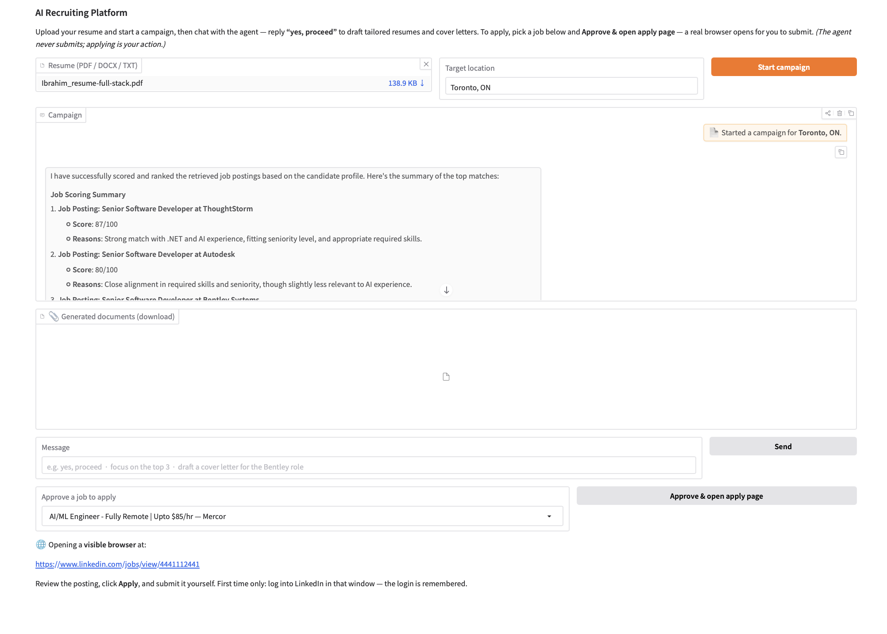
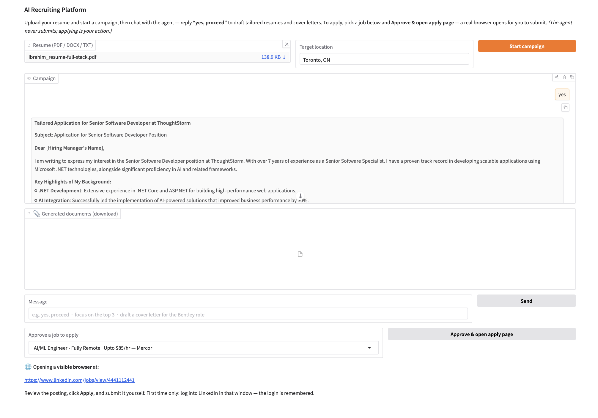

# AI Recruiter

I got tired of rewriting my resume for every job posting, so I started building this. You upload your resume, it pulls jobs from LinkedIn, ranks them against your profile, and writes a tailored resume and cover letter for the ones you pick. It does **not** apply for you. When you approve a job it opens the posting in a normal browser window and you submit it yourself. I didn't want a bot sending applications in my name.

<p align="center">
  
</p>

It's still a side project and a few parts are stubs (see the end).

## Stack

- DeepAgents for the main agent (planning + subagents)
- LangGraph for the approval step
- MCP servers for job search, ATS stuff and the browser
- JobSpy to get LinkedIn jobs
- ChromaDB for embeddings
- LangSmith for tracing and one eval
- Gradio for the UI
- Playwright for opening the browser

## How it works

1. You upload a resume (pdf, docx or txt) and hit **Start campaign**.
2. The orchestrator sends a `discovery` subagent to search LinkedIn through the job-boards MCP server, then scores each job with the rubric in `skills/matching/SKILL.md`.
3. You reply "yes, proceed" (or "just the top 3", etc). A `tailoring_worker` subagent runs per job and writes the resume + cover letter. The files show up in a download panel and are saved in `outputs/<thread_id>/`.
4. Pick a job from the dropdown and click **Approve & open apply page**. Chromium opens on the posting, logged in with a saved profile, and you finish the application yourself.

The orchestrator can't submit anything. I remove `submit_to_ats` and `submit_application` from its tool list before building it, so even if you type "apply" in the chat there's nothing it can call.

I only used two subagents. Discovery gets its own context because the raw postings are big, and tailoring runs once per job. Matching is simple enough that the main agent does it itself.

## Project layout

```
app/
  config.py            env + langsmith
  state.py             pydantic models
  skills_loader.py
  orchestrator.py      main deepagents agent
  agents/application_graph.py   langgraph approval graph
  tools/
    resume_tools.py    extract_profile, check_grounding
    mcp_client.py
    browser_apply.py   opens the apply page
  rag/vectorstore.py   chroma (not used by matching yet)
  ui/gradio_app.py     run this
mcp_servers/
  job_boards_server.py   :8001
  ats_server.py          :8002
  browser_server.py      stdio
skills/                  SKILL.md files the agents load as prompts
evals/tailoring_eval.py
deploy/
run_local.sh
```

## Setup

Needs Python 3.12. Everything is on LangChain 1.x. If an old 0.3.x package gets in, pip won't resolve, so use a fresh venv.

```bash
python3 -m venv .venv
source .venv/bin/activate
pip install -r requirements.txt
playwright install chromium
```

Then copy `.env.example` to `.env` and add your `OPENAI_API_KEY` and `LANGSMITH_API_KEY`. Nothing loads `.env` automatically, but `run_local.sh` sources it for you.

## Running

```bash
./run_local.sh
```

This starts the two MCP servers, waits for them, and launches the UI at http://localhost:7860. Ctrl+C stops everything.

If you'd rather run things by hand, start `mcp_servers/job_boards_server.py` and `mcp_servers/ats_server.py` first, then `python3 -m app.ui.gradio_app`. If the UI starts first you'll get `httpx.ConnectError: All connection attempts failed`.

The first time you click approve, log into LinkedIn in the window that opens. The profile is saved in `.browser-profile/` so you only do it once.

<p align="center">
  
</p>

## Things I ran into

- **Rate limits.** Fetching 20 full LinkedIn descriptions pushed gpt-4o-mini over its tokens-per-minute limit and everything stalled on 429s. Now search returns 10 jobs by default (15 max) and cuts each description to 800 characters.
- **Getting jobs to the UI.** Subagent tool results don't stream back to the parent, so the dropdown had nothing to show. The job-boards server now writes results to `outputs/_jobs_cache.json` and the UI reads that file. A bit hacky, but it works.
- **LinkedIn.** JobSpy scrapes public listings, which is a grey area, so keep the volume low. I stayed away from Easy Apply automation on purpose.

## Not done yet

- `extract_profile` and `check_grounding` are stubs. Tailored resumes sometimes still contain `[Your Name]`-style placeholders.
- ChromaDB indexing works, but matching doesn't use it yet. The agent ranks jobs in context.
- The LangGraph approval graph with ATS submission exists but isn't connected to the UI.
- The eval in `evals/` needs a `resume-tailoring-dataset` in LangSmith, and the tailoring function in it is a placeholder.
- It's single user. The jobs cache and browser profile are shared files on disk.

Deployment notes are in `deploy/fargate.md`.
