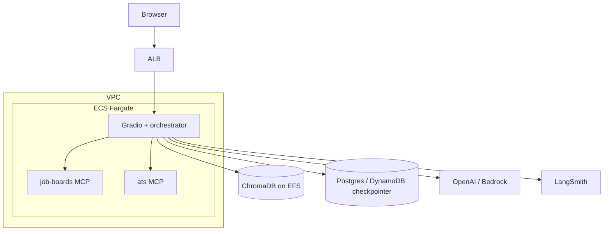

# Deploying

I haven't deployed this for real yet, these are my notes for when I do. Both options use `deploy/Dockerfile` with the repo root as build context.



## Option 1: ECS Fargate

- Gradio app + orchestrator as one service on port 7860 behind an ALB.
- job-boards and ats MCP servers as their own services. Set `JOB_BOARDS_MCP_URL=http://job-boards:8001/mcp` and `ATS_MCP_URL=http://ats:8002/mcp`. The browser MCP server is stdio so it just runs inside the app container.
- Mount EFS and point `CHROMA_DIR` at it (or move to pgvector later).
- Replace `InMemorySaver` in `app/agents/application_graph.py` with a Postgres or DynamoDB checkpointer, otherwise approvals are lost on restart.

Env vars: `OPENAI_API_KEY`, `LANGSMITH_API_KEY`, `CHROMA_DIR`, optionally `MODEL`.

```bash
docker build -f deploy/Dockerfile -t ai-recruiter:latest .
# then push to ECR and use it in the task definitions
```

## Option 2: Bedrock AgentCore

Makes more sense if I switch to Bedrock models (`MODEL=bedrock_converse:anthropic.claude-...`).

- Orchestrator on AgentCore Runtime
- MCP servers behind AgentCore Gateway
- AgentCore Memory/Observability instead of the checkpointer and LangSmith
