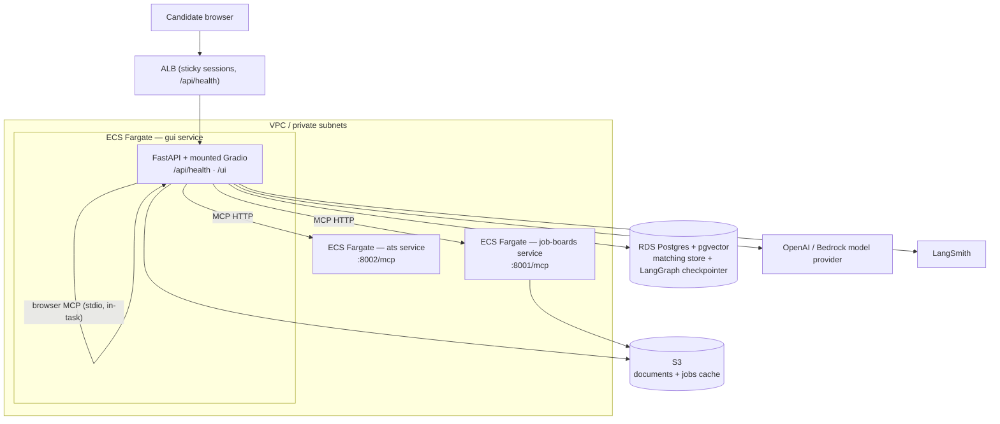

# Deployment — ECS Fargate & Bedrock AgentCore

Two supported deploy paths. Both build from `deploy/Dockerfile` (root as build context).

## Architecture



## Path A — ECS Fargate

The `gui` service follows **`rag-agent-aws-plan.md`** exactly: FastAPI + Gradio mounted
in one task (`app/main.py`), `/api/health` for the ALB, sticky sessions, RDS Postgres
with pgvector, S3 for generated documents. Start there for VPC/ALB/RDS/S3/IAM setup;
this doc only covers what's specific to this app on top of that plan.

- **`gui` service** — `app/main.py`, port 8000, behind the ALB. One task, one uvicorn
  worker (mounted Gradio requirement — see Phase 1b of the plan).
- **`job-boards` / `ats` services** — the HTTP MCP servers
  (`mcp_servers/job_boards_server.py`, `mcp_servers/ats_server.py`) run as their own
  small ECS services, same image as `gui` with the container `command` overridden.
  Reached via `JOB_BOARDS_MCP_URL` / `ATS_MCP_URL` (Phase 2c's `ecs-sg` pattern —
  allow 8001/8002 from `gui`'s security group). No ALB needed for these; internal only.
- **`browser` MCP server** — runs stdio, in the `gui` task itself, so no separate
  service. Its `submit_application` tool is unreachable today: the orchestrator strips
  it (`BLOCKED_ORCHESTRATOR_TOOLS`) and the UI's own apply button is parked (below).
- **Matching store** — `app/rag/vectorstore.py` now uses pgvector on the same RDS
  instance as the checkpointer (`DATABASE_URL`); `app/db.py` creates the `vector`
  extension at startup. Not yet wired into the ranking flow (LLM ranks in-context) —
  see README's *Known limitations*.
- **Checkpointer** — `app/db.py` wires an `AsyncPostgresSaver` from `DATABASE_URL`,
  replacing the old `InMemorySaver`, so chat threads survive task restarts.
- **Generated documents** — `app/storage.py` uploads to `S3_BUCKET` and returns
  presigned GET URLs; set `S3_BUCKET` in prod (falls back to local disk otherwise).
- **Jobs cache** — `job-boards` hands discovered postings to the UI through
  `app/storage.py` too (`JOBS_CACHE_KEY`, same S3 bucket, plain JSON not presigned).
  Works across separate `gui`/`job-boards` ECS tasks as long as both have
  `S3_BUCKET` set and `s3:PutObject`/`GetObject`/`DeleteObject` on the task role —
  `job-boards`' task role needs that too, not just `gui`'s (Phase 5a covers `gui`;
  add the same statement to `job-boards`' task role, scoped to the `cache/*` prefix).

### Required environment / secrets
Everything in `rag-agent-aws-plan.md` Phase 1c/3c, plus:
- `JOB_BOARDS_MCP_URL`, `ATS_MCP_URL` — point at the internal service DNS names.
- `S3_BUCKET` on **both** `gui` and `job-boards` (documents + jobs cache respectively).
- `OPENAI_API_KEY` — required unless `EMBEDDING_MODEL=bedrock:<model-id>`
  (`app/rag/vectorstore.py`); the LLM itself already had this Option A/B choice via
  `MODEL`, embeddings now follow the same pattern.

### Build & push
```bash
docker build -f deploy/Dockerfile -t ai-recruiter:latest .
# tag + push to ECR, then reference the image in the ECS task definitions
```

## Apply automation — parked

The old "Approve & open apply page" button drove a **visible, logged-in Chromium**
(`app/tools/browser_apply.py`) as a detached subprocess. That's a desktop pattern — it
needs a display and a persistent local browser profile — and cannot run in a headless
Fargate task. It's disabled in `app/ui/gradio_app.py:approve_and_open` (returns the job
link instead of opening a browser). Options if/when this gets revisited: hand the
candidate a link to open in *their own* browser (cheap, matches current parked
behavior), or stream a remote headed browser to the client (VNC/noVNC or similar —
significant extra infra and a security review, given the FinTech-adjacent context).

## Path B — Bedrock AgentCore

Best fit if standardizing on Bedrock models (set `MODEL=bedrock_converse:anthropic.claude-...`).

- Deploy the orchestrator to **AgentCore Runtime** via the CLI (`@aws/agentcore`).
- Expose the MCP servers through **AgentCore Gateway**.
- Use **AgentCore Memory + Observability** instead of self-managed state and LangSmith.
- Set `EMBEDDING_MODEL=bedrock:<model-id>` (e.g. `amazon.titan-embed-text-v2:0`) to
  drop `OPENAI_API_KEY` entirely — needs `langchain-aws` installed.
